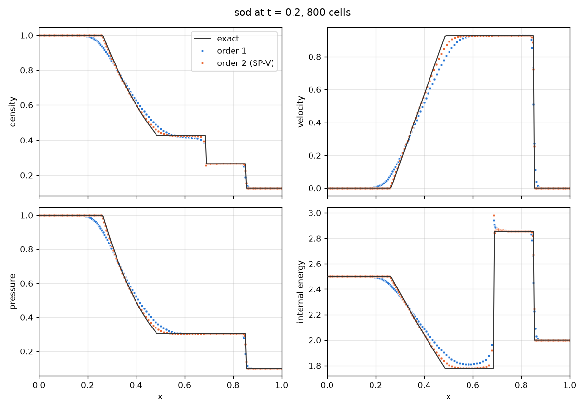
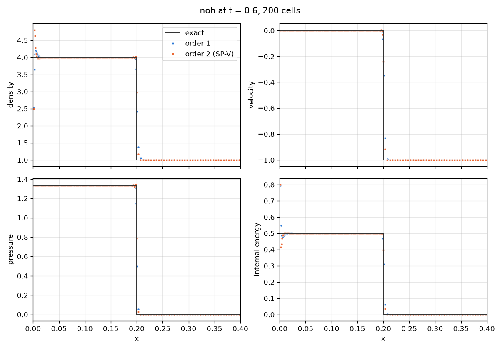
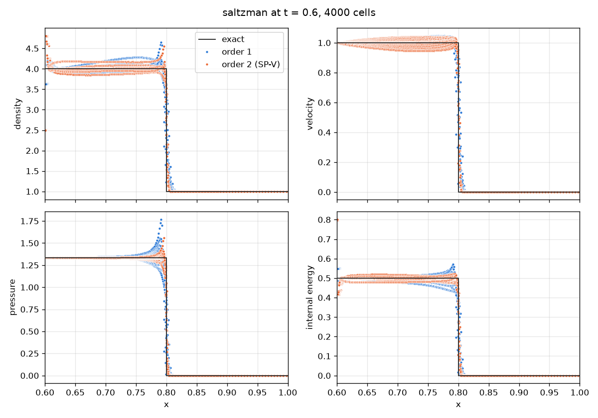
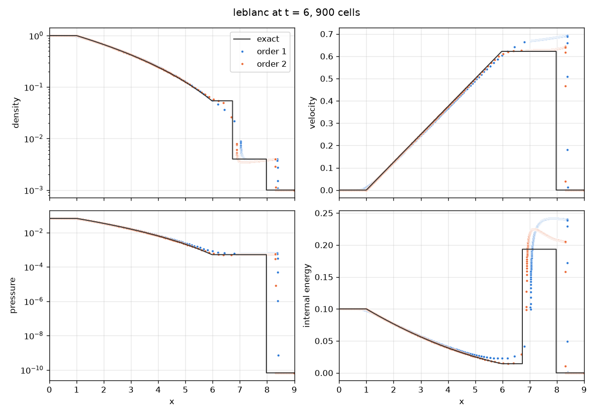
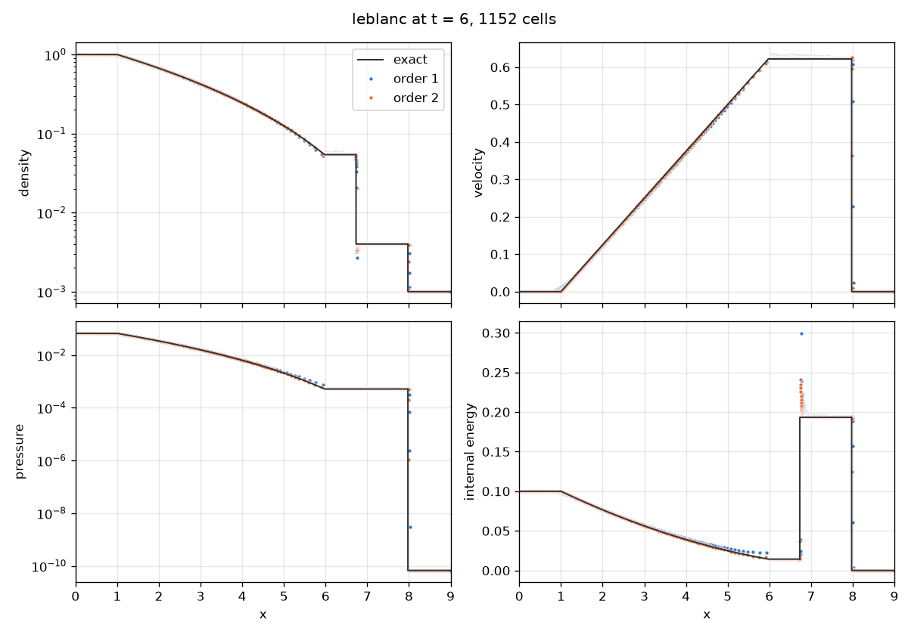
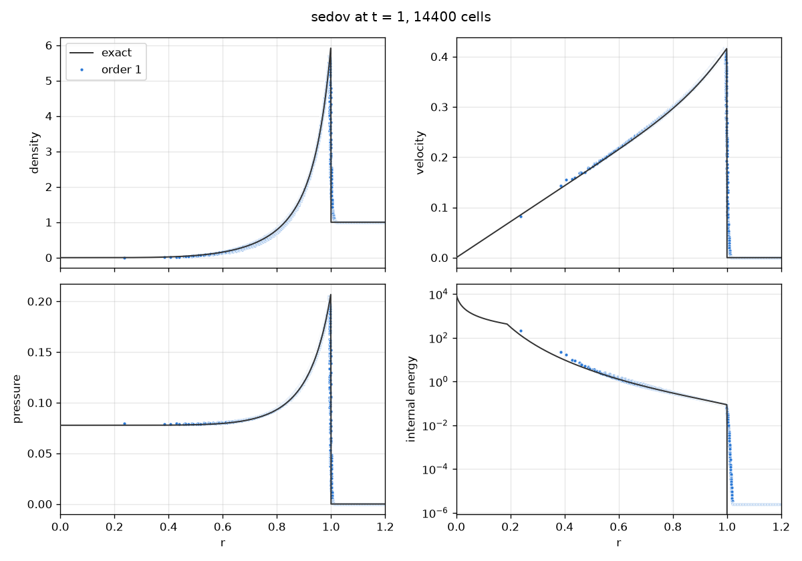

# V&V Test Catalog (Hydro Operator)

Oracle sources: **ExactPack** (`pip install git+https://github.com/lanl/ExactPack.git`)
and the **Kamm-Timmes Sedov solver** (their method, LA-UR-07-2849). Generate via
`scripts/gen_oracle_data.py`, one `CASES` entry per test, output to
`tests/oracle_data/<case>.json`.

## Already in the reference paper's suite (parity checkpoint)
| Test | Stresses | Status |
|---|---|---|
| Sod | shock/contact/rarefaction | v0.2: 3 resolutions, both orders (table below) |
| Noh | wall-heating, stagnation shock | planar, v0.2: 3 resolutions, both orders (table below) |
| Woodward-Colella blast wave | shock-shock interaction | Tier A/AMR-adjacent, defer |
| Sedov | spherical/cylindrical symmetry | not started |
| Triple point | multi-material vortex | Tier B, defer |

## Additional standard tests (not in the paper)
| Test | Stresses | Priority |
|---|---|---|
| Saltzman piston | mesh-misalignment robustness | High — v0.2: 3 resolutions, both orders (table below) |
| Taylor-Green vortex (Dobrev et al.; Georges' thesis Sec. 3.2) | smooth convergence order, distorted cells; needs an energy source | Done (v0.2, Task 14) — order 2 unlimited: L1 pressure 5.98e-4 at 160×160, order 1.95 (thesis 1.94), within 25% of the thesis's Table 3.1(b); ctest 10-40, full table `scripts/taylor_green_convergence.py` |
| **Kidder ball** | no spurious entropy under isentropic compression | **High** — most relevant to FLARE's actual drive regime |
| **Guderley converging shock** | converging-shock focusing, cylindrical symmetry | **High** — most relevant to cylindrical implosion geometry |
| LeBlanc | severe density/pressure jump, Riemann robustness | v0.3 (Tasks 19-19c): gate met on the layered meshes (shock +0.013 at order 2, 900 base); the uniform meshes are reported (shock 0.3-0.4 ahead, start-up entropy) |
| Coggeshall (pure-hydro subset) | adiabatic self-similar compression | Low — Kidder covers similar ground |
| Gresho vortex | low-Mach vorticity preservation | Low for v1.0 |

## v0.2 convergence (Task 15)
L1 density error against the exact solution, `sum_c |rho_c - rho(x_c)| V_c / A`
(A the y-z cross-section), with the observed rate between resolutions, from
`python3 scripts/convergence.py --markdown` on `decks/convergence/` (n cells
along the flow: Sod n×2×2, Noh n×1×1, Saltzman n×n/10×1 skewed). Order 2
uses the SP-V limiter. The v0.2 gate (order 2 below order 1 at every
resolution) passes on all three.

| Problem | Cells | Order 1 L1 | rate | Order 2 L1 | rate |
|---|---|---|---|---|---|
| Sod | 50 | 2.809e-02 | | 1.241e-02 | |
| Sod | 100 | 1.909e-02 | 0.56 | 6.850e-03 | 0.86 |
| Sod | 200 | 1.236e-02 | 0.63 | 3.528e-03 | 0.96 |
| Noh | 50 | 3.899e-02 | | 3.098e-02 | |
| Noh | 100 | 1.941e-02 | 1.01 | 1.562e-02 | 0.99 |
| Noh | 200 | 9.624e-03 | 1.01 | 7.914e-03 | 0.98 |
| Saltzman | 50 | 9.090e-02 | | 7.030e-02 | |
| Saltzman | 100 | 4.535e-02 | 1.00 | 3.102e-02 | 1.18 |
| Saltzman | 200 | 2.190e-02 | 1.05 | 1.559e-02 | 0.99 |

Reading the rates: with shocks, every scheme converges at order <= 1 in L1,
and a contact at order m/(m+1) for a formal order m (~1/2 and ~2/3). So
second order shows as a smaller error constant: 3.5x smaller on Sod at 200
cells, where the contact and rarefaction dominate, but only 1.2-1.4x on Noh
and Saltzman, whose error is the shock's width and the wall-heating or
start-up error. Order ~2 itself is shown on the smooth Taylor-Green vortex
(above). Order 2 at 200 cells, optimized, alone: Sod 14 s, Noh 21 s;
Saltzman 200×20 took 8.5 min with 8 runs sharing the machine (3x its
first-order run there).

### Profiles at 200 cells
The computed cells over the exact solution, both orders, from
`scripts/plot_comparison.py` on the 200-cell decks
(`decks/convergence/*_200.json` with `scheme.order` set to 1 and 2). Each
slab cell is one point, so a 2D spread shows as a band.

Sod: order 2 is sharper at the rarefaction's ends and at the contact, the
error the rates above measure. Both orders overshoot eps right of the
contact (peaks 2.94 at order 1, 2.98 at order 2, exact 2.85), the start-up
error a Lagrangian scheme leaves at a contact.

Noh: the plateau and the two-cell shock match the exact solution at both
orders. The error is the wall heating in the first cells (rho 2.5 in cell
1, peak 4.81 at order 2; eps 0.8), as in Task 15.

Saltzman: the band is the 20 rows of the skewed mesh. Just behind the
shock some rows overshoot in pressure, up to 1.77 at order 1 and 1.56 at
order 2 (exact 4/3); behind that, both orders keep a spread of about ±5%
in x-velocity and a few percent in rho between rows.

## LeBlanc (Task 19)
Planar shock tube, gamma = 5/3, (rho, eps) = (1, 0.1) for x < 3 and
(1e-3, 1e-7) beyond, walls at x = 0 and 9, t = 6 (`decisions.md`, "v0.3
test problems"; `decks/convergence/leblanc_<n>.json`, n×1×1 cubic cells).
Exact solution: contact at 6.731, shock at 7.975, rho 4e-3, u 0.622, eps
0.1933 between them. `convergence.py`'s Riemann solver and ExactPack's
(`tests/oracle_data/leblanc.json`) agree to 1.1e-11 in density
(`--check-oracles`). From `python3 scripts/convergence.py --problems leblanc
--markdown`; "shock" is the last crossing of rho = 2.5e-3:

| Problem | Cells | Order 1 L1 | rate | shock | Order 2 L1 | rate | shock |
|---|---|---|---|---|---|---|---|
| LeBlanc | 225 | 8.864e-02 | | 7.719 | 4.125e-02 | | 8.220 |
| LeBlanc | 450 | 6.727e-02 | 0.40 | 8.159 | 3.177e-02 | 0.38 | 8.369 |
| LeBlanc | 900 | 4.527e-02 | 0.57 | 8.383 | 1.871e-02 | 0.76 | 8.311 |
| LeBlanc | 1800 | 3.181e-02 | 0.51 | 8.398 | (not run) | | |

Uniform meshes, reported, not gated (Task 19b; the gate runs on the
layered meshes below): every run reaches t = 6, the error falls with
resolution at both orders and order 2 is below order 1 at every
resolution, but at 900 cells the shock is 0.41 (order 1) and 0.34 (order
2) ahead of 7.975, not within 0.1. The 1800-cell order-1 run (off the gate, 10.5 min) puts it at 8.398,
so the offset is not shrinking yet. Costs at 900 cells, optimized, alone:
order 1 ~2 min (7255 steps), order 2 ~7 min (6614 steps).

What goes wrong, measured, not tuned:
- *Too much push behind the contact.* The shocked gas moves too fast: u
  0.70 behind the shock at 450 cells, 0.67-0.69 at 900, 0.65-0.66 at 1800
  (order 1; exact 0.622), with P and eps above the exact plateau by the
  same margin. The plateau state converges, slowly; the shock position
  integrates the larger overdrive of earlier times, so it converges later. The heavy gas between the
  rarefaction's tail (x = 5.97) and the contact holds 0.041 of mass,
  one initial cell at 225 cells and ~4 at 900: those few cells cannot
  expand down to the exact pressure, and push the light gas harder than
  p* = 5.16e-4. Total energy is conserved to round-off; the shocked gas's
  excess energy is ~5e-4 at 450 cells, 0.2% of the 0.3 in the box, which
  is enough to move a gas 1000 times lighter.
- *Early lag.* At 225 cells the shock is behind the exact one until
  t ~ 4 (-0.41 at t = 2 at order 1), while it forms over a few cells; the
  overdrive then carries it past. At 450 and up the overdrive wins.
- *Not the timestep:* CFL 0.1 instead of 0.25 at 450 cells (order 1)
  moves the shock by 0.01.
- *Order 2* gets the plateau velocity closer (0.628-0.636 at 900) but its
  shock is still 0.34 ahead, and its plateau has a gradient (u rising
  towards the shock, eps falling), the overdrive of earlier times.
- *Contact eps overshoot*, the known one: eps peaks at 0.242 (order 1)
  and 0.225 (order 2) at 900 cells against 0.1933, and in the first light
  cells next to the contact density rises to ~9e-3 (exact 4e-3) with eps
  dropping, the start-up error at the contact.
- *Robustness, the risks of Task 16:* none hit. The cold gas keeps eps at
  its 1e-7 exactly (no negative eps, no floor needed), Newton converges in
  the 1e9 pressure ratio with the global flux scale, SP-V gives a flow
  that stays exactly 1D (transverse velocity < 1e-15), and the gas ahead
  of the shock is untouched beyond its precursor (0.30 ahead at 225 cells,
  order 1).

### Why the shock is ahead (Task 19b)
Not a defect: the scheme is right, the uniform mesh is too coarse where it
matters, a thin layer of heavy gas at the contact. From
`python3 scripts/leblanc_1d.py`, an independent 1D model of the order-1
step (same two-shock nodal solve, forward Euler, same dt controller; it
puts the shock where hydro_run does to 2e-4 at 225, 450 and 900 cells):

| Mesh (order 1, 1D model) | Cells | Shock | Error |
|---|---|---|---|
| uniform | 900 | 8.384 | +0.409 |
| uniform | 1800 | 8.398 | +0.424 |
| uniform | 3600 | 8.298 | +0.323 |
| uniform | 7200 | 8.186 | +0.211 |
| uniform | 14400 | 8.103 | +0.128 |
| light gas only refined, x16 (0.01 heavy cells) | 9900 | 8.397 | +0.422 |
| heavy gas only refined, x16 (0.01 light cells) | 5400 | 8.098 | +0.123 |
| 900, only [2.95, 3] refined x16 | 975 | 8.091 | +0.116 |
| 900, only [2.95, 3] refined x64 | 1215 | 8.010 | +0.035 |
| 900, only [2.95, 3] refined x256 | 2175 | 7.981 | +0.007 |
| 900, only [2.99, 3] refined x64 | 963 | 8.091 | +0.116 |

- *It converges, slowly.* On uniform meshes the error peaks near 1800
  cells and then falls (+0.13 at 14400 cells, rate 0.6-0.7); hydro_run's 225 to
  1800 are the start of that curve.
- *Only the heavy gas next to the contact matters.* Refining the light
  gas changes nothing; refining the heavy gas fixes it, and refining just
  [2.95, 3], the 0.05 of heavy gas that becomes the plateau between the
  rarefaction's tail and the contact (0.041 of mass), fixes it as well:
  +0.007 with that layer 256 times finer, on 2175 cells. [2.99, 3] alone
  is not enough.
- *Mechanism: start-up entropy.* At t = 0 the heavy gas faces almost a
  vacuum (a 1e9 pressure ratio). The first heavy cell expands against a
  face pressure far below its own, so it does less work than the
  isentrope would and keeps the difference as internal energy: its
  entropy P / rho^gamma ends 5.3 times the initial value at 900 cells, the
  next cells' 2.4 and 1.6 times (exact: 1, the rarefaction is
  isentropic). Those few cells are the whole heavy plateau at 900 cells,
  so at the plateau's density they hold too much pressure (6.2e-4 against
  p* = 5.16e-4) and push the light gas too hard. The damaged mass is a
  fixed number of cells, so it shrinks with the cell mass; once the
  plateau is many cells deep the contact pressure is right. With the
  layer refined 256 times, the plateau's entropy is within 2% of the
  initial value and the shock within 0.007.
- *Not the solver's approximation:* the exact Riemann solver at every
  interface (Lagrangian Godunov, `--solver exact`) is worse, +0.84 at 450
  cells and +0.60 at 1800, and converges the same way (+0.42, +0.26,
  +0.15 at 3600, 7200, 14400). Not the timestep either (CFL 0.1: 0.01).
- *Literature:* the same loss of shock-speed accuracy, blamed on the
  internal-energy overshoot at the contact, a start-up error of the
  wall-heating kind, is reported for Eulerian schemes too, which need
  ~2000 cells or explicit contact diffusion (Ramani, Reisner and
  Shkoller, arXiv:1806.08023, Sec. 5.4).

So the bound (0.1) is out of reach on uniform meshes until ~10^4 cells.
Decided with Luca (2026-11-26, Task 19b option (c)): the gate runs on
meshes with the heavy layer at the contact refined; the uniform family
stays, reported.

### Gated: a refined layer at the contact (Task 19c)
`decks/convergence/leblanc_layer_<n>.json`: the n-cell uniform mesh (slab
width 9/n) with [2.96, 3] refined 64 times, through `mesh.x_segments`:
288, 576 and 1152 cells for n = 225, 450, 900. [2.96, 3] rather than
19b's [2.95, 3], which does not fit the 225 mesh (cells 0.04); the 1D model
gives +0.051, +0.035, +0.031 with it (a wider layer, [2.92, 3], does worse
on the coarse bases: +0.127 at 225). hydro_run's order-1 runs match the
1D model exactly (same steps, shocks to 1e-4). From
`python3 scripts/convergence.py --problems leblanc_layer --markdown`:

| Base n | Cells | Order 1 L1 | rate | shock | Order 2 L1 | rate | shock |
|---|---|---|---|---|---|---|---|
| 225 | 288 | 7.234e-02 | | 8.026 | 1.270e-02 | | 7.996 |
| 450 | 576 | 4.437e-02 | 0.71 | 8.010 | 5.728e-03 | 1.15 | 7.996 |
| 900 | 1152 | 2.659e-02 | 0.74 | 8.006 | 2.115e-03 | 1.44 | 7.988 |

The gate (`roadmap.md`) **passes**: every run reaches t = 6, the error
falls at both orders, order 2 is below order 1 everywhere (5-13 times),
and at the 900 base the shock is +0.031 (order 1) and +0.013 (order 2)
from 7.975, within 0.1. Behind the shock at the 900 base: u 0.624-0.629
and 0.6232-0.6236 (exact 0.622), eps 0.193-0.197 and 0.1933-0.1941
(exact 0.1933), plateau rho 4.04e-3 and 4.01e-3. The eps spike at the
contact remains (peaks 0.299 at order 1, 0.241 at order 2, in the first
light cells): the light side's own start-up error, which no longer
reaches the shock. Order 2 converges faster than on the uniform meshes
(rates 1.15 and 1.44 against 0.38 and 0.76): with the start-up error
gone, the error is the waves' widths. Costs at the 900 base: order 1
6980 steps, order 2 7819 steps, ~13 min with 3 other runs sharing the
machine (est. ~10 min alone, above the order-1 1D model's 7600 steps);
the four other runs, 15 s to 3 min. No robustness problem: eps never
below the cold gas's 1e-7, flow 1D (|v_y| < 2e-15).

## Sedov, cylindrical (Task 22)
`decks/convergence/sedov_<n>.json`: the quarter plane [0, 1.2]^2, n x n
x 1 cubic cells (slab 1.2/n), walls on all sides, gamma = 1.4, rho = 1,
P = 1e-6 at rest, `initial.energy_spike` 0.246019 per unit length at the
origin (the corner cell). Exact: ExactPack `Sedov(geometry=2, eblast = 4 x
0.246019)` in `tests/oracle_data/sedov.json` (every 0.001 on r in [0, 1.7],
shock at r = 1.0000005, rho 6 behind it). Metric: radial L1 per unit
length at the centroid radius; shock = the densest cell's radius; spread =
the largest max - min of density in a radial bin one cell wide, over the
bins behind the shock.

**Order 1** (`convergence.py --problems sedov --orders 1`):

| n | Order 1 L1 | rate | shock | peak rho | spread | steps | time |
|---|---|---|---|---|---|---|---|
| 30 | 1.664e-01 | | 0.968 | 5.01 | 2.11 | 508 | 7 s |
| 60 | 1.161e-01 | 0.52 | 0.981 | 5.45 | 1.91 | 1601 | 3.2 min* |
| 120 | 5.227e-02 | 1.15 | 0.992 | 5.70 | 0.91 | 5185 | 32 min* |

(* with 2-3 other runs on 4 cores.) Total energy conserved to round-off
(0.2460225960 per unit length: the spike plus the background's 3.6e-6),
v_z below 4e-16, mirror symmetry about the diagonal to 7e-14, the gas
ahead untouched. The shock is within 0.05 of 1 at every resolution. The
spread mixes in the steep radial gradient across a bin next to the shock,
so it is large near the shock by construction; it falls with resolution.
The steps grow ~3.2x per doubling, not 2x: dt is set by the hot cells at
the origin. **Cost**: the 120 run is above the ~15 min budget at order 1,
and order 2 (~4x per step) would be about an hour.

(ExactPack's eps has a kink at r ~ 0.19, inside the near-vacuum core
where no cell is at t = 1; not used by the metric.) Georges' thesis
Figs. 3.13-3.15 are the *spherical* Sedov on 20^3 cells, not this
problem, so they are not overlaid.

### Order 2 with SP-V fails (the finding)
Order 2 with SP-V stops with a negative internal energy in a cold cell
just ahead of the shock: step 85 at n = 30 (t = 0.086, cell 156 at r =
0.34, near the diagonal), step 86 at 60, step 101 at 120. CFL 0.1 does
not help (step 150, same cell). With `"limiter": "none"` order 2 runs to
t = 1 at n = 30 (L1 0.156, shock 0.992).

Cause (probed with `--probe 156`): ahead of the shock the cell carries a
precursor velocity of ~1e-7 (2e-7 of its neighbours' 0.4), pointing
almost tangentially (V_c ~ (-0.73, 0.68) at (0.26, 0.22)). SP-V limits the
velocity gradient only through its projection on u_c = V_c / |V_c|
(`decisions.md`, "Limiter: SP-V"), and the 1e-8 "negligible speed"
threshold of Task 13 (tuned on Sod's 1e-17 round-off) lets this vector
through. The incoming radial gradient is then nearly unlimited in the
cell; its corner velocities overshoot and the kinetic energy exceeds the
cell's total energy as the shock arrives.

Check (throwaway build, not committed): with the threshold at 1e-2 (that
cell falls back to the pressure-gradient direction, radial), order 2
runs to t = 1:

| n | Order 2 L1 (threshold 1e-2) | shock | peak rho | spread |
|---|---|---|---|---|
| 30 | 1.101e-01 | 0.981 | 5.65 | 1.51 |
| 60 | 4.842e-02 | 0.991 | 6.01 | 1.34 |

below order 1 at both (0.166, 0.116). Not adopted: it changes the scheme
(and possibly the v0.2 dumps), so it is a decision for its own task, as
the Task 16 plan says for an SP-V failure on Sedov. Decided (Luca,
2026-11-26): fix the direction rule rather than switch to the MM limiter;
`backlog.md`, Task 22b.

## Methodology (run alongside every test, not a test itself)
- **Grid Convergence Index / Richardson extrapolation** (Roache) — run every
  test at ≥3 resolutions, assert observed order matches formal order, not
  just "passes at one resolution."
- **Method of Manufactured Solutions** — the only rigorous way to verify the
  AMR remap/refine/coarsen operator in isolation (relevant from v0.4 on);
  none of the exact-solution tests above isolate AMR from the base hydro
  scheme.

## v0.1 priority order
Sod → Noh → Saltzman → Kidder → Guderley → (Sedov, LeBlanc as time allows)
