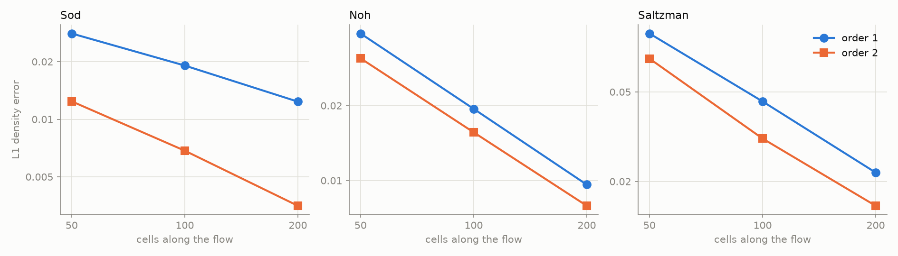

# V&V Test Catalog (Hydro Operator)

Oracle sources: **ExactPack** (`pip install git+https://github.com/lanl/ExactPack.git`)
and the **Kamm-Timmes Sedov solver** (their method, LA-UR-07-2849). Generate via
`scripts/gen_oracle_data.py`, one `CASES` entry per test, output to
`tests/oracle_data/<case>.json`.

## Already in the reference paper's suite (parity checkpoint)
| Test | Stresses | Status |
|---|---|---|
| Sod | shock/contact/rarefaction | v0.2: 3 resolutions, both orders (table below) |
| Noh | wall-heating, stagnation shock | planar, v0.2: 3 resolutions, both orders (table below) |
| Woodward-Colella blast wave | shock-shock interaction | Tier A/AMR-adjacent, defer |
| Sedov | spherical/cylindrical symmetry | not started |
| Triple point | multi-material vortex | Tier B, defer |

## Additional standard tests (not in the paper)
| Test | Stresses | Priority |
|---|---|---|
| Saltzman piston | mesh-misalignment robustness | High — v0.2: 3 resolutions, both orders (table below) |
| Taylor-Green vortex (Dobrev et al.; Georges' thesis Sec. 3.2) | smooth convergence order, distorted cells; needs an energy source | Done (v0.2, Task 14) — order 2 unlimited: L1 pressure 5.98e-4 at 160×160, order 1.95 (thesis 1.94), within 25% of the thesis's Table 3.1(b); ctest 10-40, full table `scripts/taylor_green_convergence.py` |
| **Kidder ball** | no spurious entropy under isentropic compression | **High** — most relevant to FLARE's actual drive regime |
| **Guderley converging shock** | converging-shock focusing, cylindrical symmetry | **High** — most relevant to cylindrical implosion geometry |
| LeBlanc | severe density/pressure jump, Riemann robustness | Medium |
| Coggeshall (pure-hydro subset) | adiabatic self-similar compression | Low — Kidder covers similar ground |
| Gresho vortex | low-Mach vorticity preservation | Low for v1.0 |

## v0.2 convergence (Task 15)
L1 density error against the exact solution, `sum_c |rho_c - rho(x_c)| V_c / A`
(A the y-z cross-section), with the observed rate between resolutions, from
`python3 scripts/convergence.py --markdown` on `decks/convergence/` (n cells
along the flow: Sod n×2×2, Noh n×1×1, Saltzman n×n/10×1 skewed). Order 2
uses the SP-V limiter. The v0.2 gate (order 2 below order 1 at every
resolution) passes on all three.

| Problem | Cells | Order 1 L1 | rate | Order 2 L1 | rate |
|---|---|---|---|---|---|
| Sod | 50 | 2.809e-02 | | 1.241e-02 | |
| Sod | 100 | 1.909e-02 | 0.56 | 6.850e-03 | 0.86 |
| Sod | 200 | 1.236e-02 | 0.63 | 3.528e-03 | 0.96 |
| Noh | 50 | 3.899e-02 | | 3.098e-02 | |
| Noh | 100 | 1.941e-02 | 1.01 | 1.562e-02 | 0.99 |
| Noh | 200 | 9.624e-03 | 1.01 | 7.914e-03 | 0.98 |
| Saltzman | 50 | 9.090e-02 | | 7.030e-02 | |
| Saltzman | 100 | 4.535e-02 | 1.00 | 3.102e-02 | 1.18 |
| Saltzman | 200 | 2.190e-02 | 1.05 | 1.559e-02 | 0.99 |

Reading the rates: with shocks, every scheme converges at order <= 1 in L1,
and a contact at order m/(m+1) for a formal order m (~1/2 and ~2/3). So
second order shows as a smaller error constant: 3.5x smaller on Sod at 200
cells, where the contact and rarefaction dominate, but only 1.2-1.4x on Noh
and Saltzman, whose error is the shock's width and the wall-heating or
start-up error. Order ~2 itself is shown on the smooth Taylor-Green vortex
(above). Order 2 at 200 cells, optimized, alone: Sod 14 s, Noh 21 s;
Saltzman 200×20 took 8.5 min with 8 runs sharing the machine (3x its
first-order run there).

## Methodology (run alongside every test, not a test itself)
- **Grid Convergence Index / Richardson extrapolation** (Roache) — run every
  test at ≥3 resolutions, assert observed order matches formal order, not
  just "passes at one resolution."
- **Method of Manufactured Solutions** — the only rigorous way to verify the
  AMR remap/refine/coarsen operator in isolation (relevant from v0.4 on);
  none of the exact-solution tests above isolate AMR from the base hydro
  scheme.

## v0.1 priority order
Sod → Noh → Saltzman → Kidder → Guderley → (Sedov, LeBlanc as time allows)
